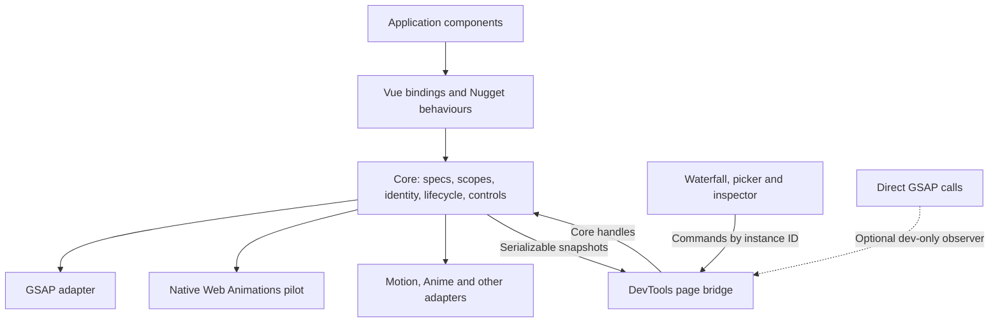
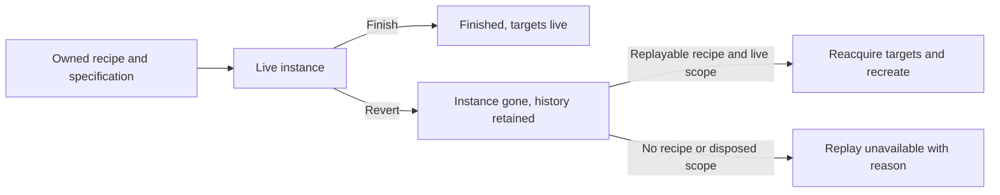

# Provider-neutral Nugget and DevTools

Status: **proposed design; implementation pending**.

GSAP is a provider. Nugget core owns animation specifications, identity, lifecycle and
controls; DevTools consumes core records and handles. A second-provider application with
GSAP absent from its dependency graph and production bundle proves the separation.

## Architecture



| Boundary | Responsibility |
| --- | --- |
| Core | Specifications, presets, scopes, provider selection, instance identity, animation graph, lifecycle, rebuild and hooks |
| Provider adapter | Translate properties/timing, create native animations, report state, execute supported controls and edits |
| Vue | Component-owned scopes, composables, directives and components; disposal on unmount |
| Nuxt | Load configuration, auto-import bindings and install development tooling |
| DevTools page bridge | Observe core records, publish snapshots, resolve element picks and dispatch validated commands |
| DevTools panel | Waterfall, picker controls, capability-driven inspector, edit comparison and copy prompts |

Core imports neither an animation engine nor Vue/Nuxt/DevTools. Native handles, DOM access
and provider libraries stay behind explicit target, splitter and provider boundaries.
DevTools exchanges serializable data; native animation objects and elements stay in the page.

## Configuration and packaging

Proposed application configuration:

```ts
// nugget.config.ts
import { defineNuggetConfig } from "@fdcn/nugget/config";
import { motion } from "@fdcn/nugget/providers/motion";
import { gsap } from "@fdcn/nugget/providers/gsap";
import { SplitText } from "gsap/SplitText";

export default defineNuggetConfig({
  plugins: [motion(), gsap({ plugins: [SplitText], only: ["splitText"] })],
});
```

- Runtime configuration holds provider/plugin functions; `nuxt.config.ts` holds serializable
  build settings. The server may load configuration, but providers execute only in the browser.
- Provider selection is per ability. The first configured provider for an ability wins;
  `only` restricts registration. Missing abilities produce a typed diagnostic naming the ability.
- Provider imports determine bundling. Engine packages are optional peers of their adapter
  entry points. A non-GSAP configuration does not install or bundle GSAP.
- Applications without explicit provider configuration retain GSAP as the compatibility
  default during the migration. The non-GSAP fixture always configures its provider explicitly.
- Explicit engine APIs such as `useGsap` retain their engine-specific meaning. Their native
  calls require an optional observer for DevTools visibility and do not imply rebuild support.

Use module boundaries first. Extract packages when their real consumers justify distribution:

| Package | Contents |
| --- | --- |
| `@fdcn/nugget-core` | Runtime, provider contracts and opt-in provider/plugin entry points |
| `@fdcn/nugget-vue` | Vue-owned scopes and bindings |
| `@fdcn/nugget` | Nuxt integration and convenient re-exports |
| `@fdcn/nugget-devtools` | Page bridge, panel and devframe host integration |

The public APIs shown here are design examples, not available exports.

## Core contracts

### Specifications and controls

Proposed call site:

```ts
const scope = nugget.scope();
const intro = scope.animate(title, {
  from: { opacity: 0, y: "100%" },
  to: { opacity: 1, y: 0 },
  timing: { duration: 0.6, ease: { type: "bezier", points: [0.23, 1, 0.32, 1] } },
  trigger: { type: "scroll-enter", start: "top 80%" },
});

intro.pause();
intro.seek(0.5);
scope.dispose();
```

- Specifications describe target references, properties, timing and triggers. Providers
  translate them into native options; GSAP `vars` and stagger internals remain adapter details.
- Define common units and semantics: seconds for time, normalized progress for seeking,
  CSS pixels for numeric translations and explicit units for string values. Specify repeat,
  direction and completion behaviour independently of engine defaults.
- Sequences contain child records with explicit offsets. Manual-time and scroll-driven
  playback have distinct control contracts; scrolling must not silently override a seek command.
- Core wraps each native instance in a handle. Common callers never inspect its internals;
  a typed provider-specific escape hatch remains available to application code.
- Provider failures and unsupported commands return typed results. Unsupported behaviour
  cannot silently succeed. Validate external commands once at the bridge boundary.

### Identity and state

- Core generates a unique **instance ID**. Authored labels and source/recipe identities are
  separate facts: one call site can create many instances.
- Core owns parent/child relationships. Replay changes progress and timing without changing
  row identity or ordering. Replacements receive a new instance/revision linked to their recipe.
- Model playback (`waiting`, `running`, `paused`, `finished`) separately from lifetime
  (`live`, `reverted`, `disposed`) using tagged states and explicit valid transitions.
- Core retains native resources only while the owning scope and instance lifecycle allow it.
  DevTools retains bounded historical summaries and defines eviction for selected records/edits.

### Capabilities and edits

- Model supported commands alongside the operations that implement them; independent flags
  must not disagree with available controls.
- Each animation describes editable fields, valid values and read-only reasons. Providers
  supply only their supported abilities: animation, sequence, scroll enter/scrub, split text,
  smooth scrolling or a global clock. The UI derives controls from capabilities.
- Common edits update the authoritative specification. An adapter may update safely in place;
  otherwise it rebuilds through the owned recipe and restores supported playback state.
  Failed edits preserve the working instance or report its actual failure state.
- Easing is tagged: shared named curves, bezier/steps or explicit provider-specific easing.
  Native parsing/conversion stays outside the panel; it receives curve data to draw.
- Provider-specific controls use an explicit extension boundary. The generic panel has no
  `provider === "gsap"` branches or imports of GSAP/CustomEase.
- Copy prompts use provider name, source hint and before/after specifications. Provider
  extensions supply engine-specific source/registration guidance.

## Ownership, replay and split text

The recipe, live instance and history record have separate lifetimes:



- A scope owns animations, split DOM, scroll triggers, listeners and drivers. Disposal is
  idempotent, releases all resources and prevents later rebuilds.
- Replay rebuilds only Nugget-owned resources with an explicitly replayable recipe.
  A historical reference to removed DOM is insufficient.
- Split/re-split acquires fresh target elements and updates registered relationships.
  Stale handles cannot control the replacement instance.
- Application callbacks can navigate, mutate state or remove components. Preview/replay
  policy is explicit at creation; production semantics remain intact. DevTools does not
  suppress arbitrary callbacks or resurrect application DOM to simulate replay.

## DevTools and plugins

- Core emits typed creation, state, disposal and split/re-split events. The page bridge
  builds snapshots from these events and samples progress only while a panel subscribes.
- Commands resolve instance IDs to core handles; teardown stops polling, picking and subscriptions.
- Global controls use an available provider clock or operate on registered live handles.
- The element picker resolves registered live target relationships, including animated split
  descendants and nearest animated ancestors. Multiple matches remain individually selectable.
- Optional direct-engine observers are dev-only adapters with explicit ownership. HMR and
  disposal restore patched methods and remove subscriptions.
- Hook plugins observe core events. A typed before-create hook may transform the specification;
  hook names and wire records are versioned contracts.
- Nuxt, plain Vite and standalone devframe hosts share the panel/bridge. Host adapters own
  mounting and authentication. The Nugget dock button remains independent of the Nuxt group.
- Production builds exclude DevTools, observers and source-tagging transforms.
- Save-to-source is deferred until neutral editing works: tagged call sites, authenticated
  workspace-bounded RPC, an AST-aware diff preview, and explicit handling of nonliteral values.

## Migration work

| Current location | Migration |
| --- | --- |
| `packages/nuxt/src/runtime/functions/` | Route neutral behaviours through scopes; preserve explicit engine helpers |
| `src/runtime/devtools/page-script.ts` | Replace native GSAP discovery/control with the core bridge |
| `src/runtime/devtools/animation-registry.ts` | Move instance identity/graph to core; keep waterfall history in DevTools |
| `src/runtime/devtools/gsap-edit.ts` | Keep native editing inside the GSAP adapter |
| `devtools-panel/ease.ts` | Consume neutral easing and provider-supplied curve data |
| `devtools-panel/prompt.ts` | Format neutral edits and explicit provider hints |
| `src/runtime/functions/use-split-text*` | Move split resource/recreation ownership into scoped abilities |

Paths without a package prefix are relative to `packages/nuxt/`.

Each phase delivers a complete behaviour through its real boundary:

| Phase | Deliverable | Acceptance evidence |
| --- | --- | --- |
| 1. Characterize | Baseline composables, directives and components | Tests for defaults, callbacks, scroll, reduced motion, sequence order and unmount cleanup; browser cases for replay and split lifetimes |
| 2. GSAP vertical slice | One neutral specification/scope/handle and GSAP adapter; migrate `useAnimateOnScroll` | Same visible animation and callbacks; supported controls work; unmount releases drivers/listeners |
| 3. Neutral DevTools | Waterfall, picker, editing and prompts operate on that slice through core | Live click/edit-to-instance round trip; neutral bridge/panel have no engine imports |
| 4. Second-provider proof | Small common slice implemented with native Web Animations | Same browser scenarios with GSAP absent; dependency/build graph checks; unsupported controls explain why |
| 5. Rebuild | Owned sequence and split-text recipes | Repeated replay, resize/re-split, mid-play revert/disposal and failed rebuild; no stale-target playback |
| 6. Behaviour migration | Presets, composables, directives and components migrate individually | Behaviour and provider contracts remain green; each migrated behaviour has a live browser check |
| 7. Distribution | Extract useful package boundaries and document migration | Non-GSAP app installs/builds without GSAP; production excludes DevTools; legacy applications retain a tested compatibility path |

Motion, Anime and smooth-scroll adapters follow the second-provider proof. Read each engine's
current documentation and installed types before choosing its capability contract.

## Verification and release

- Shared provider scenarios cover repeatable controls, progress, errors, completion, supported
  edits and disposal. Real provider/browser tests establish external behaviour.
- Browser scenarios cover picker-to-row focus, multiple targets, identical labels, repeated
  replay, nested sequences, scroll-driven controls and split cleanup.
- Boundary checks reject engine imports in core, the neutral bridge and panel. The non-GSAP
  fixture proves installation, runtime and bundle independence.
- Run repository formatting, lint, type, test and build gates; record pre-existing failures.
  Source directories include ownership and usage READMEs.
- Preserve explicitly GSAP APIs and application behaviour during migration. Shared public
  property changes and removal of compatibility paths ship in a major release.

## Decisions requiring approval

- Approve any new production dependency before implementation, including the runtime effect/
  resource-management dependency required by the active TypeScript discipline.
- Agree the initial portable property/easing subset and unsupported-operation UX before
  publishing provider contracts. The second-provider pilot is the acceptance boundary.

## Out of scope

Arbitrary reconstruction of externally reverted split DOM, automatic replay of application
side effects, universal support for every engine feature, simultaneous implementation of all
providers, a toolchain migration, and automatic source rewriting in the initial slice.

## References

- Current implementation: `packages/nuxt/src/runtime/devtools/`,
  `packages/nuxt/devtools-panel/` and `packages/nuxt/src/runtime/functions/use-split-text/`.
- GSAP [SplitText lifecycle](https://gsap.com/docs/v3/Plugins/SplitText/) and
  [startTime](https://gsap.com/docs/v3/GSAP/Tween/startTime/): split lifetimes and timing
  changes require explicit target ownership and stable instance identity.
