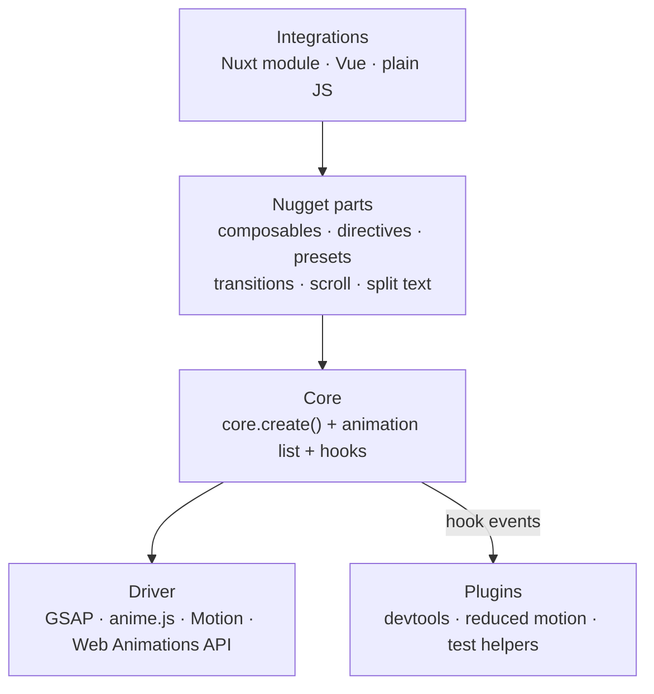
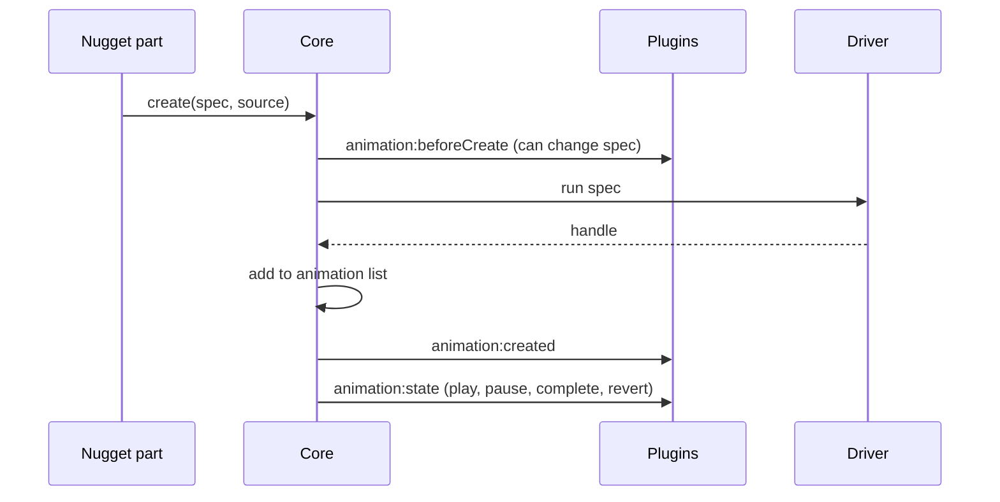
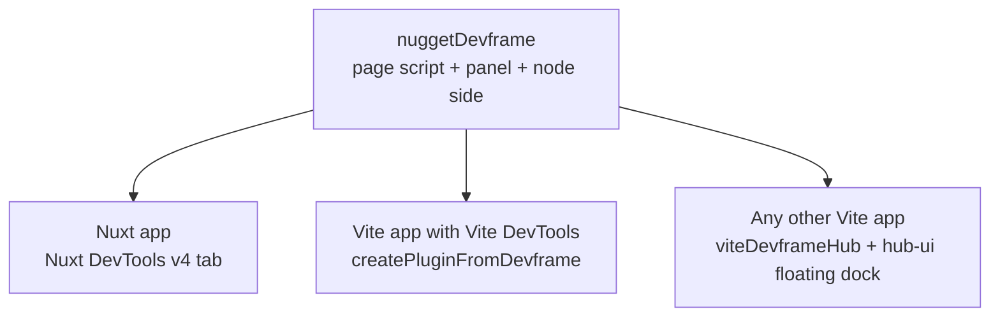
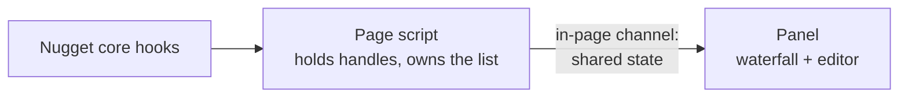
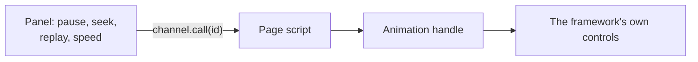
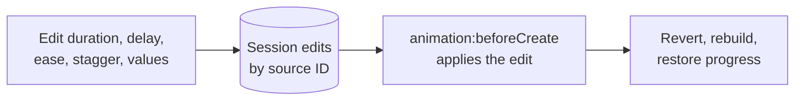
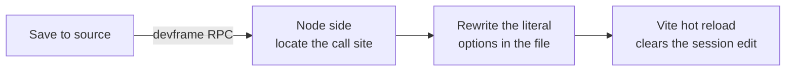

# Providers, plugins and devtools

Make Nugget work with any animation framework, let plugins observe and change every animation, and ship a devtools panel with a waterfall, playback controls and live editing that can save back to source.

## Status

| Step | State |
|---|---|
| Move out of the Web repo into its own repository | Done |
| Bun workspace monorepo, Nuxt module in `packages/nuxt` | Done |
| Declare `tinyglobby`, `@vueuse/nuxt`, `@vueuse/core` as runtime dependencies | Done |
| Dev toolchain on Nuxt 4.6, Vite 8 and Nuxt DevTools v4 | Done |
| Devtools spike: GSAP-only waterfall with pause, replay, seek, speed and hover highlighting in Nuxt DevTools | Done |

## Architecture



### One animation through core



## Packages

| Package | Contents |
|---|---|
| `@fdcn/nugget-core` | Driver interface, drivers as subpath exports (`/drivers/gsap`, `/drivers/anime`, `/drivers/motion`, `/drivers/waapi`), animation list, hooks, presets, step lists. No Vue or Nuxt |
| `@fdcn/nugget-vue` | Composables, directives, components |
| `@fdcn/nugget` | Nuxt module: auto-imports, presets template, `provider` option, devtools mounting in dev |
| `@fdcn/nugget-devtools` | `nuggetDevframe` definition, page script, panel app, channel protocol, save-to-source node side, and a Nuxt module (`@fdcn/nugget-devtools/nuxt`) that `@fdcn/nugget` installs in dev once the package is published |

## Drivers

Every driver returns the same handle:

```ts
const anim = core.create({ targets: el, from: { opacity: 0 }, to: { opacity: 1, duration: 0.6 } }, source)
anim.pause(); anim.seek(0.5); anim.speed(0.25); await anim.finished; anim.revert()
anim.capabilities // → { scrub: true, globalPause: false, … }
```

| Capability | GSAP | anime.js 4 | Motion | Web Animations API |
|---|---|---|---|---|
| Tweens | `to` / `fromTo` | `animate` | `animate` | `el.animate` |
| Sequences | `timeline` | `createTimeline` | sequence arrays | computed delays |
| Play on enter | ScrollTrigger | `onScroll` | `inView` | IntersectionObserver |
| Scrub with scroll | ScrollTrigger | `onScroll` sync | `scroll()` | `ViewTimeline` |
| Split text | SplitText | `splitText` | Nugget's own splitter (Motion's is paid) | Nugget's own splitter |
| Pause everything | Global timeline | `engine.pause()` | Loop over the list | Loop over the list |
| Global speed | `timeScale()` | `engine.speed` | Loop, set `speed` | Loop, set `playbackRate` |

| Decision | Choice |
|---|---|
| Choosing a provider | Module option, decided when the app builds |
| Framework packages | Optional peer dependencies |
| Property and ease names | Shared names translated per driver, released as 2.0. GSAP names stay as deprecated aliases for one major |
| Missing features | Fail clearly in development, based on `capabilities` |
| Smooth scroll | Its own `smoothScroll: 'gsap' \| 'lenis' \| false` setting, independent of the provider |

## Plugin system

```ts
export default defineNuggetPlugin({
  name: "nugget:devtools",
  setup(nugget) {
    nugget.hooks.hook("animation:created", (record) => { /* … */ })
  },
})
```

| Hook | Sent by |
|---|---|
| `animation:beforeCreate` (the only hook that can change things) | Core |
| `animation:created`, `animation:state` | Core |
| `sequence:created` | Transitions, timelines |
| `preset:resolved` | Baked presets |
| `scroll:enter`, `scroll:leave` | Scroll triggers |
| `split:created`, `split:resplit` | Split text |
| `smoothScroll:created` | Smooth scroll |

| Concern | Decision |
|---|---|
| Single entry point | Every part creates animations through `core.create()` |
| Production cost | No plugins means no animation list, and hooks do nothing |
| Plugin errors | Caught and logged |
| Contract | Hook names and the record shape are versioned public API |

## Devtools on devframe

Nuxt DevTools v4 is built on devframe, so one `defineDevframe` definition serves every host.



**Recording**



**Controlling**



| Concern | Decision |
|---|---|
| Mounting in Nuxt | `addVitePlugin(createPluginFromDevframe(nuggetDevframe, { dock: { groupId: "nuxt", category: "modules" } }))` puts the tab in the Nuxt group |
| Requirements | Nuxt 4.5+ (Vite 8) with `@nuxt/devtools` v4 set through package-manager `overrides` |
| Panel to page | devframe in-page channel. Records are plain data; handles and elements stay in the page |
| Source of truth | The page script owns the shared state |
| Page script loading | A client plugin in the app's own bundle, so it shares the app's GSAP and Nugget instances. Live progress only while a panel is connected |
| Data source | Core hooks. Until core exists, the page script wraps `gsap.to`, `from`, `fromTo` and `timeline`, and skips GSAP plugin tweens on plain objects |
| Scroll-scrubbed animations | Progress shown, time seeking disabled |
| Production | Devtools, source tagging and save-to-source are installed only in dev |

## Live editing

Edits apply instantly in the page. Literal values can then be saved back to the source file, and Vite hot-reloads the result.

**Applying an edit**



**Saving to source**



| Part | Job |
|---|---|
| Source tagging | A Vite transform tags each Nugget composable call with `file:line:col`. Directives get their element's location from `vite-plugin-vue-tracer`. The location also becomes the animation's stable ID |
| Rebuild | Core reverts the animation, rebuilds it from the edited spec and restores its progress. This mirrors anime.js `scope.keepTime()` for every driver |
| Locating the call site | Parse the file, `@vue/compiler-sfc` for `.vue`, find the options object at the tagged location |
| Writing | Changes only the edited keys, through AST-aware edits. Baked presets in `nuxt.config` go through `magicast` |
| Non-literal values | Fields built from variables or expressions are marked "runtime only" and offered as "Copy as code" |
| Safety | Writes go through devframe's authenticated RPC, only inside the workspace root, only to tagged Nugget call sites, with a diff preview before each write |
| Hosts without a node side | Save is disabled and "Copy as code" remains |

## Order of work

1. Publish `@fdcn/nugget` 1.1.0, then commit the prepared Web changes and regenerate `www/bun.lock`.
2. Add tests that pin the behaviour of each composable and directive in `packages/nuxt/test`.
3. Create `packages/core`: driver interface, handle, animation list, hooks, GSAP driver. Route every part in `packages/nuxt/src/runtime` through `core.create()`.
4. Add rebuild-and-restore-progress to core, tested on GSAP including staggers and re-split text.
5. Switch the page script's data source to core hooks, and mount `nuggetDevframe` in a plain Vite app through `viteDevframeHub`.
6. Spike source tagging and one save-to-source round trip for `useAnimateOnScroll` and `v-aos`.
7. Devtools v1: live editing, save to source and the floating dock, on top of the waterfall and controls.
8. Split `packages/vue` from `packages/nuxt`.
9. Motion, anime.js and Web Animations API drivers, each passing the rebuild tests.
10. Reduced-motion and test-helper plugins.

## Deferred

- Showing animations not created through Nugget.
- Devtools for apps without Vite.
- Coding-agent tools over devframe's MCP and WebMCP support.
- Vue DevTools timeline output.

## Risks

| Risk | Mitigation |
|---|---|
| Nuxt DevTools v4 is beta, `@vitejs/devtools-kit` is 0.8, devframe's hub client API is marked experimental | Pin exact versions; the playground runs Nuxt DevTools v4, so breakage shows up during development |
| Rebuilding mid-play lands at a slightly different point per framework | Shared rebuild tests per driver |
| Source tagging misses unusual call patterns | Untagged animations are read-only in the editor and can still be copied as code |
