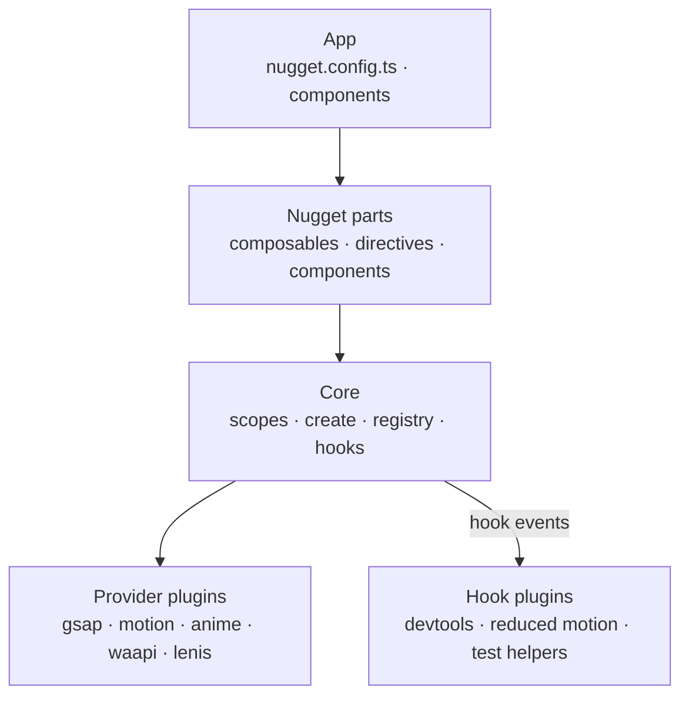
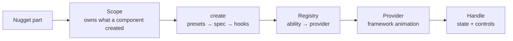
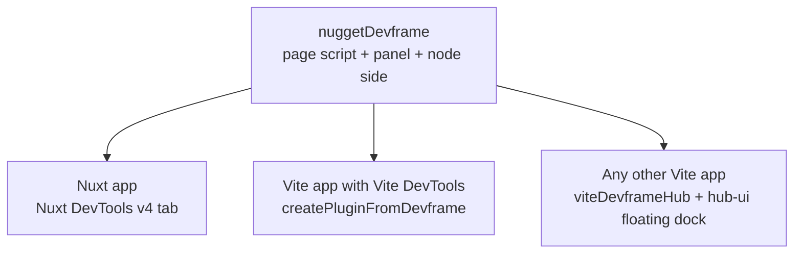
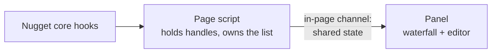
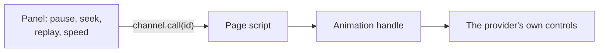
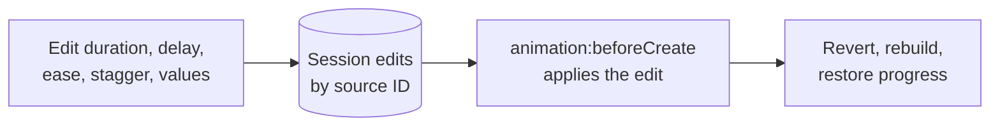
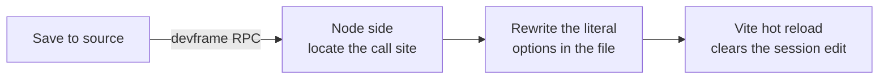

# Providers, plugins and devtools

Make Nugget work with any animation framework through provider plugins, let plugins observe and change every animation, and ship a devtools panel with a waterfall, playback controls and live editing that can save back to source.

## Status

| Step | State |
|---|---|
| Move out of the Web repo into its own repository | Done |
| Bun workspace monorepo, Nuxt module in `packages/nuxt` | Done |
| Declare `tinyglobby`, `@vueuse/nuxt`, `@vueuse/core` as runtime dependencies | Done |
| Dev toolchain on Nuxt 4.6, Vite 8 and Nuxt DevTools v4 | Done |
| Devtools spike: GSAP-only waterfall with pause, replay, seek, speed and hover highlighting in Nuxt DevTools | Done |
| Devtools spike: inspector that edits duration, delay, stagger, repeat, yoyo, ease and from/to values of a running GSAP tween, with reset; edits last until reload | Done |
| Devtools spike: ease editor with a curve gallery, in/out/in-out, knobs for power, back, elastic and steps, and draggable bezier handles (GSAP CustomEase, registered by the devtools in dev) | Done |
| Devtools: play or scrub a single timeline step; hint when an element has no size | Done |
| Devtools: copy a prompt for a coding agent from the inspector (one animation or a timeline's steps) or the header (every edit), naming each animation's component and file | Done |
| Devtools built into `@fdcn/nugget`: dev only, skipped without Nuxt DevTools v4, `nugget.devtools: false` turns them off, nothing in production builds | Done |
| Devtools: stable first-seen row order and unique internal IDs; removed SplitText targets explicitly unavailable; element picker focuses matching animations, including split descendants | Done (unreleased) |

## Architecture



## Packages

| Package | Contents |
|---|---|
| `@fdcn/nugget-core` | `createNugget`, scopes, registry, hooks, presets, rebuild, `defineNuggetPlugin`, `defineNuggetConfig`, built-in providers (`/providers/gsap`, `/providers/motion`, `/providers/anime`, `/providers/waapi`, `/providers/lenis`) and built-in hook plugins (`/plugins`: `reducedMotion`, test helpers). No Vue, Nuxt or animation framework |
| `@fdcn/nugget-vue` | Composables, directives, components; one core scope per component |
| `@fdcn/nugget` | Nuxt module: auto-imports, presets, loading `nugget.config.ts`, devtools in dev. Re-exports core's `/config`, `/providers/*` and `/plugins`, so a Nuxt app installs only this package |
| Devtools | Built into `@fdcn/nugget`: `src/devtools.ts` (devframe definition, dev only), `src/runtime/devtools/` (page script, GSAP edits, channel protocol) and `devtools-panel/` (built into `dist/devtools-panel`). They move to a framework-neutral `@fdcn/nugget-devtools` when a plain Vite app needs them (step 5), along with the save-to-source node side |

## Configuration

Provider and hook plugins are functions and classes, so they live in `nugget.config.ts`, bundled into the browser build. This follows `@nuxtjs/i18n`'s `i18n.config.ts`, which holds runtime options that cannot be serialized.

```ts
// nugget.config.ts
import { defineNuggetConfig } from "@fdcn/nugget/config"
import { gsap } from "@fdcn/nugget/providers/gsap"
import { lenis } from "@fdcn/nugget/providers/lenis"
import { motion } from "@fdcn/nugget/providers/motion"
import { reducedMotion } from "@fdcn/nugget/plugins"
import { SplitText } from "gsap/SplitText"

export default defineNuggetConfig({
  plugins: [
    motion({ defaults: { duration: 0.5 } }),
    gsap({ plugins: [SplitText], only: ["splitText"] }),
    lenis({ lerp: 0.1 }),
    reducedMotion(),
  ],
})
```

`nuxt.config.ts` keeps plain build-time options: custom presets, devtools and auto-imports.

App code is the same for every provider. Framework-specific settings sit under the framework's name and type-check only when that plugin is configured:

```ts
const { fromTo } = useAnimate()
fromTo(card, {
  from: { opacity: 0, scale: 0.9 },
  to: { opacity: 1, scale: 1, motion: { type: "spring", bounce: 0.3 } },
})
```

| Concern | Decision |
|---|---|
| No config file | Behaves like `plugins: [gsap()]`, so 1.x apps keep working |
| Bundling | Only the providers imported in `nugget.config.ts` are bundled |
| Server | The config is imported on the server but no provider runs there |
| Types | The configured plugins determine the types of framework-specific settings and of `handle.raw` |

## Core



| File | Job |
|---|---|
| `nugget.ts` | `createNugget(config)`: builds the registry, runs plugin `setup`s, exposes `scope()`, `hooks`, `animations` |
| `registry.ts` | One provider per ability, `only` filtering, missing-ability errors |
| `spec.ts` | Framework-neutral description: shared property names, ease names, triggers |
| `presets.ts` | Preset names to spec |
| `scope.ts` | Ownership; disposing a scope reverts everything it created |
| `handle.ts` | Wraps a provider's animation into shared controls, tracks state, sends hooks |
| `rebuild.ts` | Rebuilds from an edited spec and restores progress |
| `hooks.ts` | Typed event bus |
| `providers/*` | Built-in providers and Nugget's own text splitter |

```ts
const nugget = createNugget(config)
const scope = nugget.scope()

const intro = scope.animate(title, {
  from: { opacity: 0, y: "100%" },
  to: { opacity: 1, y: 0, duration: 0.6, ease: "power3.out", stagger: 0.1 },
  trigger: { type: "scroll-enter", start: "top 80%" },
}, { source: "app/pages/index.vue:14:3" })

intro.pause(); intro.seek(0.5); intro.speed(0.25)
await intro.finished

const enter = scope.sequence([
  { target: parent, set: { overflow: "hidden" } },
  { target: main, to: { scaleX: 1, duration: 0.8, ease: "power4.inOut" } },
  { target: offset, to: { scaleX: 1, duration: 0.8, ease: "power4.inOut" }, at: 0 },
], { paused: true })

scope.splitText(heading, { by: "lines", mask: true, autoSplit: true }, (pieces) =>
  scope.animate(pieces.lines, { from: { y: "100%" }, to: { y: 0, stagger: 0.1 } }),
)

scope.smoothScroll({ smooth: 1 })
scope.dispose()
```

Each Nugget part becomes a thin layer over a scope:

```ts
export function useBakedAnimateOnScroll(el, { animationOptions, tweenValues, scrollAnimationOptions = true }) {
  const scope = useNuggetScope()
  whenElement(el, (target) =>
    scope.animate(target, bakedSpec(animationOptions, tweenValues, scrollAnimationOptions)),
  )
}
```

### Data model

```ts
type AnimationSpec = {
  from?: Props
  to: Props & Timing
  trigger?: { type: "now" } | { type: "scroll-enter"; start?: string } | { type: "scroll-scrub"; start?: string; end?: string }
}
// Props: opacity, hidden, x, y, scale, scaleX, scaleY, rotate, skewX, skewY, filter, transformOrigin,
// plus framework-specific settings: { gsap: {…} } | { motion: {…} } | …
// Timing: duration, delay, ease, stagger, repeat, yoyo

type PlayState = "waiting" | "running" | "paused" | "finished" | "reverted"

type AnimationRecord = {
  id: string            // given id, else source location, else counter
  source?: string
  provider: string
  targets: Element[]
  parentId?: string     // sequence step or split-text piece
  trigger: AnimationSpec["trigger"]
  state: PlayState
}
```

### `scope.animate`, step by step

1. Resolve presets and check ease names into one spec.
2. Run `animation:beforeCreate` on a copy of the spec.
3. Look up the provider for `animate`, and for `scrollEnter` or `scrollScrub` when triggered.
4. Call the provider and wrap the result in a handle.
5. Add the handle to the scope and the live list; send `animation:created`.
6. Send `animation:state` on each change; remove from the list on revert.

| Concern | Decision |
|---|---|
| Server rendering | Core needs the DOM when called; the Vue layer calls it after mount |
| Ownership | Every animation, split and smoother belongs to a scope; disposing it is the one cleanup path |
| Memory | The live list holds animations whose scope exists and that are not reverted. Waterfall history belongs to the devtools |
| States | One `PlayState` per animation |
| Errors | Missing abilities, unknown presets and unknown eases throw in development. Provider failures reject `finished` |
| Translation | Providers turn shared property and ease names into framework terms; core owns the shared names and presets |
| Effect | Not in shipped code. Scopes own resources, `PlayState` models states, and `finished` is the only promise, so apps take no Effect dependency |

## Providers

A provider is a plugin that supplies abilities:

```ts
import { animate, inView } from "motion"

export const motion = (options: MotionOptions = {}) =>
  defineNuggetPlugin({
    name: "motion",
    provides: {
      animate: (targets, spec) =>
        toHandle(animate(targets, toKeyframes(spec), { ...options.defaults, ...toTiming(spec) })),
      scrollEnter: (el, onEnter) => inView(el, onEnter),
    },
  })
```

An app replaces one ability with its own plugin:

```ts
const mySplitter = defineNuggetPlugin({
  name: "my-splitter",
  provides: { splitText: (el, { by }) => splitIntoSpans(el, by) },
})
```

| Ability | `gsap()` | `motion()` | `anime()` | `waapi()` | Others |
|---|---|---|---|---|---|
| `animate` | `to` / `fromTo` | `animate` | `animate` | `el.animate` | |
| `sequence` | `timeline` | sequence arrays | `createTimeline` | computed delays | |
| `scrollEnter` | ScrollTrigger | `inView` | `onScroll` | IntersectionObserver | |
| `scrollScrub` | ScrollTrigger | `scroll()` | `onScroll` sync | `ViewTimeline` | |
| `splitText` | SplitText | (paid in Motion+) | `splitText` | | Nugget's own splitter |
| `smoothScroll` | ScrollSmoother | | | | `lenis()` |
| `globalClock` (pause all, global speed) | global timeline | | `engine` | | Core loops over the live list when absent |

| Concern | Decision |
|---|---|
| Resolution | One provider per ability; the first listed wins and dev logs the choice. `only` narrows a provider |
| Missing ability | Dev error naming the ability and the plugins that supply it |
| Packaging | Built-in providers are subpath exports of core with their framework as an optional peer dependency. Third-party providers are packages built with `defineNuggetPlugin` |
| Shared names | Released as 2.0. GSAP property names stay as deprecated aliases for one major |

## Hook plugins

```ts
export const reducedMotion = () =>
  defineNuggetPlugin({
    name: "reduced-motion",
    setup(nugget) {
      if (!matchMedia("(prefers-reduced-motion: reduce)").matches) return
      nugget.hooks.on("animation:beforeCreate", (spec) => {
        spec.to.duration = 0
      })
    },
  })
```

A plugin can both `provide` abilities and `setup` hooks.

| Hook | Sent by |
|---|---|
| `animation:beforeCreate` (the only hook that can change things) | Core |
| `animation:created`, `animation:state` | Core |
| `sequence:created` | `scope.sequence` |
| `preset:resolved` | Presets |
| `scroll:enter`, `scroll:leave` | Scroll triggers |
| `split:created`, `split:resplit` | `scope.splitText` |
| `smoothScroll:created` | `scope.smoothScroll` |

| Concern | Decision |
|---|---|
| Production cost | Without hook plugins, hooks do nothing |
| Plugin errors | Caught and logged |
| Contract | Hook names and the record shape are versioned public API |

## Devtools on devframe

Nuxt DevTools v4 is built on devframe, so one `defineDevframe` definition serves every host.



**Recording**



**Controlling**



| Concern | Decision |
|---|---|
| Mounting in Nuxt | `addVitePlugin(createPluginFromDevframe(devframe, { dock: { category: "app" } }))` gives Nugget its own dock button. Not in the Nuxt group: with devframe 1.2.6, reloading with a group member selected loads Nuxt DevTools behind it, and Nuxt DevTools then takes the selection |
| Requirements | Nuxt 4.5+ (Vite 8) with `@nuxt/devtools` v4 set through package-manager `overrides` |
| Panel to page | devframe in-page channel. Records are plain data; handles and elements stay in the page |
| Source of truth | The page script owns the shared state |
| Page script loading | A client plugin in the app's own bundle, so it shares the app's Nugget instance. Live progress only while a panel is connected |
| Data source | Core hooks. Until core exists, the page script wraps `gsap.to`, `from`, `fromTo` and `timeline`, and skips GSAP plugin tweens on plain objects |
| Global controls | `globalClock` when the provider has one, otherwise a loop over the live list |
| Scroll-scrubbed animations | Progress shown, time seeking disabled |
| Production | Devtools, source tagging and save-to-source are installed only in dev |

## Live editing

Edits apply instantly in the page. Literal values can then be saved back to the source file, and Vite hot-reloads the result.

**Applying an edit**



**Saving to source**



| Part | Job |
|---|---|
| Source tagging | A Vite transform tags each Nugget composable call with `file:line:col`. Directives get their element's location from `vite-plugin-vue-tracer`. The location is the animation's stable ID |
| Rebuild | `rebuild.ts`, shared with split-text re-splits |
| Locating the call site | Parse the file, `@vue/compiler-sfc` for `.vue`, find the options object at the tagged location |
| Writing | Changes only the edited keys through AST-aware edits. Presets in `nuxt.config` go through `magicast` |
| Non-literal values | Marked "runtime only" and offered as "Copy as code" |
| Custom ease curves | Saved as GSAP CustomEase path strings. Saving one must also register CustomEase in the app, because the devtools only register it in dev |
| Safety | Writes go through devframe's authenticated RPC, only inside the workspace root, only to tagged call sites, with a diff preview before each write |
| Hosts without a node side | Save is disabled and "Copy as code" remains |

Until core exists, the devtools edit GSAP tweens in place (`packages/nuxt/src/runtime/devtools/gsap-edit.ts`): it renders the tween back to where its start values were recorded, changes `vars` (and every per-target copy of a staggered tween), invalidates, and restores progress. This keeps the app's and ScrollTrigger's references valid. An edit is keyed by GSAP's object rather than a source location, so it is lost when the component remounts.

## Order of work

1. Publish `@fdcn/nugget` 1.1.0, then commit the prepared Web changes and regenerate `www/bun.lock`.
2. Add behaviour tests for every composable, directive and component in `packages/nuxt/test`, plus browser checks on the playground.
3. Create `packages/core` with scopes, registry, hooks, presets and the `gsap()` provider. Load `nugget.config.ts` from the Nuxt module and route every part in `packages/nuxt/src/runtime` through scopes. The behaviour tests stay green.
4. Add `rebuild.ts`, tested on GSAP including staggers and re-split text.
5. Switch the devtools page script to core hooks, and mount `nuggetDevframe` in a plain Vite app through `viteDevframeHub`.
6. Spike source tagging and one save-to-source round trip for `useAnimateOnScroll` and `v-aos`.
7. Devtools v1: live editing, save to source and the floating dock.
8. Split `packages/vue` from `packages/nuxt`.
9. `motion()`, `anime()`, `waapi()` and `lenis()` providers, each passing the behaviour scenarios and rebuild tests.
10. `reducedMotion()` and test-helper plugins.

## Deferred

- Showing animations not created through Nugget.
- Devtools for apps without Vite.
- Coding-agent tools over devframe's MCP and WebMCP support.
- Vue DevTools timeline output.

## Risks

| Risk | Mitigation |
|---|---|
| Nuxt DevTools v4 is beta, `@vitejs/devtools-kit` is 0.8, devframe's hub client API is marked experimental | Pin exact versions; the playground runs Nuxt DevTools v4, so breakage shows up during development |
| Rebuilding mid-play lands at a slightly different point per provider | Shared rebuild tests per provider |
| Source tagging misses unusual call patterns | Untagged animations are read-only in the editor and can still be copied as code |
| Apps mix Nugget with direct framework calls | `useGsap` and `handle.raw` stay available; those animations stay outside devtools and plugins |
