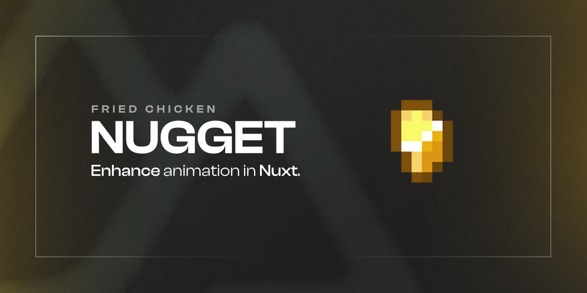
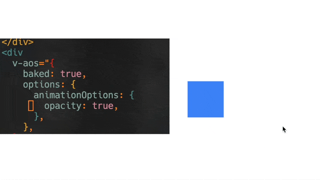
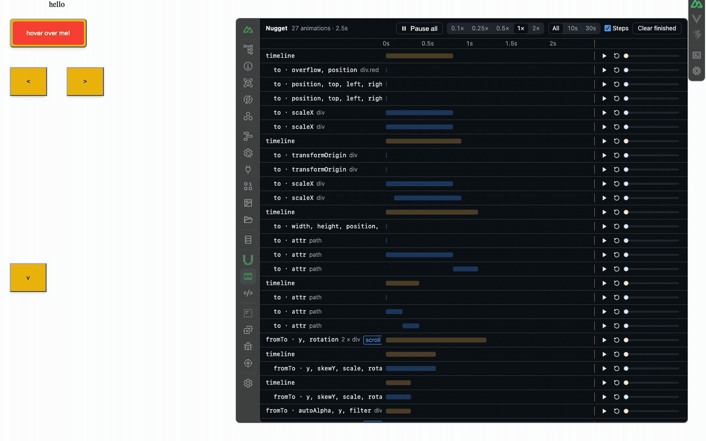

<!--
Get your module up and running quickly.

Find and replace all on all files (CMD+SHIFT+F):
- Name: Nugget
- Package name: @fdcn/nugget
- Description: Democratise premium animations using nugget.
-->

# Nugget



[![npm version][npm-version-src]][npm-version-href]
[![npm downloads][npm-downloads-src]][npm-downloads-href]
[![License][license-src]][license-href]
[![Nuxt][nuxt-src]][nuxt-href]

Democratize **premium** animations using nugget. Nugget exposes different
headless, unstyled composables and components to allow you to have the
flexibility to animate what you want, but also has sane, beautiful presets that
you do not have to break your head over.

- [✨ Release Notes](/CHANGELOG.md)
<!-- - [🏀 Online playground](https://stackblitz.com/github/your-org/@fdcn/nugget?file=playground%2Fapp.vue) -->
- [📖 Documentation](https://nugget.stevenjohn.co) 



## Usage

```vue
<script setup lang="ts">
const container = ref<HTMLDivElement | null>(null);

const { play } = useBakedTransition({
  parentContainer: container,
  animationOptions: {
    translate: true,
    scale: "in",
    skew: "bottom",
  },
});
</script>

<template>
  <button @click="play()">Hello!</button>
  <h1
    v-split-animate="{
      baked: true,
      options: {
        splitBy: 'lines',
        animationOptions: { translate: true },
        splitOptions: {
          wrapping: {
            select: 'lines',
            wrapClass: 'inline-block overflow-hidden',
          },
        },
      },
    }"
  >
    Nuxt is so cool, and this module is quite awesome.
  </h1>
</template>
```

## Quick Setup

1. Add `@fdcn/nugget` dependency to your project

```bash
# Using pnpm
pnpm add -D @fdcn/nugget

# Using yarn
yarn add --dev @fdcn/nugget

# Using npm
npm install --save-dev @fdcn/nugget
```

2. Add `@fdcn/nugget` to the `modules` section of `nuxt.config.ts`

```js
export default defineNuxtConfig({
  modules: ["@fdcn/nugget"],
});
```

That's it! You can now use Nugget Module in your Nuxt app ✨

## Devtools

During development, Nugget adds a **Nugget** tab to Nuxt DevTools.



- **Waterfall:** every GSAP animation the app creates, with timeline steps and live progress. Hover a row to highlight its element on the page.
- **Inspect element:** click the picker, then an element on the page to select and scroll to its animation in the waterfall. It also finds animated words or lines inside a heading. When several animations match, use the numbered buttons to switch between them. Esc cancels the picker.
- **Playback:** pause, replay or scrub any animation or a single timeline step. Pause everything, or slow it all down to 0.1×.
- **Live editing:** click a row to change its duration, delay, stagger, repeat, values and ease. The page updates straight away. The ease editor has a gallery of curves, knobs for power, back, elastic and steps, and draggable bezier handles.
- **Copy prompt:** turn your edits into a prompt for your coding agent. It names the component and file each animation comes from and lists every change. Copy one animation's edits from the inspector, or all of them from the header when nothing is selected.

Edits last until the page reloads; the prompt is how they reach your code.

Rows stay in first-seen order when you replay them. If your app removes animation targets (for example, calling `SplitText.revert()` after a reveal), those historical rows show **removed targets** and cannot replay the deleted spans. Trigger the reveal again in the app to create live targets; the devtools won't rebuild or replace your app's DOM.

The devtools need Nuxt 4.5 or later and Nuxt DevTools v4, which is in beta. Nugget skips them otherwise. To try Nuxt DevTools v4, pin it in your `package.json`. This is `overrides` for npm and Bun, and `pnpm.overrides` for pnpm:

```json
{
  "overrides": {
    "@nuxt/devtools": "4.0.0-beta.7"
  }
}
```

They're never part of production builds. To turn them off in development:

```ts
export default defineNuxtConfig({
  nugget: { devtools: false },
});
```

Custom curves from the ease editor are GSAP [CustomEase](https://gsap.com/docs/v3/Eases/CustomEase/) eases. The devtools register CustomEase during development; to keep a custom curve, register it in your app too.

## Roadmap

- [x] Make non-scroll controlled infinite marquee.
- [x] Make hover stop marquee.
- [x] Docs page
- [x] Custom baked presets [(#2)](https://github.com/StevenJPx2/nugget/issues/2)
- [x] Simplify directives [(#6)](https://github.com/StevenJPx2/nugget/issues/6)
- [ ] Button hover effects [(#3)](https://github.com/StevenJPx2/nugget/issues/2)
- [ ] Page transitions [(#5)](https://github.com/StevenJPx2/nugget/issues/5)
- [ ] Tests
- [ ] Image hover effects
- [ ] Tooltip effects
- [ ] Vue version

## Development

Run these from the repository root. The module lives in `packages/nuxt` and the playground in `playground`.

```bash
# Install dependencies
bun install

# Generate type stubs
bun run dev:prepare

# Develop with the playground
bun run dev

# Build the playground
bun run dev:build

# Run ESLint
bun run lint

# Run Vitest
bun run test
bun run test:watch

# Release new version
bun run release
```

<!-- Badges -->

[npm-version-src]: https://img.shields.io/npm/v/@fdcn/nugget/latest.svg?style=flat&colorA=18181B&colorB=28CF8D
[npm-version-href]: https://npmjs.com/package/@fdcn/nugget
[npm-downloads-src]: https://img.shields.io/npm/dm/@fdcn/nugget.svg?style=flat&colorA=18181B&colorB=28CF8D
[npm-downloads-href]: https://npmjs.com/package/@fdcn/nugget
[license-src]: https://img.shields.io/npm/l/@fdcn/nugget.svg?style=flat&colorA=18181B&colorB=28CF8D
[license-href]: https://npmjs.com/package/@fdcn/nugget
[nuxt-src]: https://img.shields.io/badge/Nuxt-18181B?logo=nuxt.js
[nuxt-href]: https://nuxt.com
[gsap-href]: https://gsap.com/
[locomotive-href]: https://github.com/locomotivemtl/locomotive-scroll/tree/v5-beta
