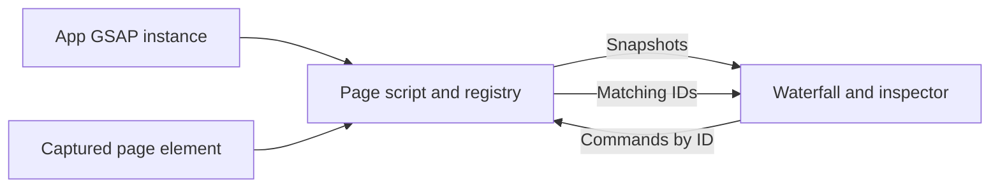

# DevTools page runtime

This directory is the **current GSAP adapter and page bridge**, not a provider-neutral core.
Nuxt installs `plugin.client.ts` only in development when Nugget DevTools is enabled and the
host is compatible. The built panel lives in `packages/nuxt/devtools-panel/`.

| Module | Responsibility |
| --- | --- |
| `plugin.client.ts` | Starts the page script with the host app's GSAP and development workspace path |
| `page-script.ts` | Observes GSAP creation, publishes snapshots while panels subscribe, dispatches controls/edits, and coordinates highlighting/picking |
| `animation-registry.ts` | Unique object identities, stable first-seen hierarchy, live-target matching and detached-target replay checks |
| `element-picker.ts` | Owns temporary capture listeners/cursor; excludes the dock's shadow tree; cancels after a pick, on Esc or when disabled |
| `gsap-edit.ts` | Inspects and edits GSAP tweens, including per-target stagger internals |
| `protocol.ts` | Shared serializable panel/page contract; native animation objects and elements never cross the channel |

For example, the panel begins picking with `channel.call("setPicker", true)`. The page
captures a click without activating the application element, then publishes `picker.ids` and
an incremented `picker.sequence`. The panel reveals the best match and marks other matches.
`channel.call("setPicker", false)` removes the picker listeners and restores the cursor.

Authored GSAP IDs remain labels; internal IDs identify object instances. Replay can change
timing but not row order. SplitText pieces removed by the application are historical targets:
their rows explain the limitation and cannot replay/edit detached DOM.

Run `bun run test` and `bun run lint` from `packages/nuxt`; use the playground for browser
checks of the real channel/picker. Do not infer provider independence from registry unit tests.
The migration design is in
[`docs/plans/providers-plugins-devtools.md`](../../../../../docs/plans/providers-plugins-devtools.md).
